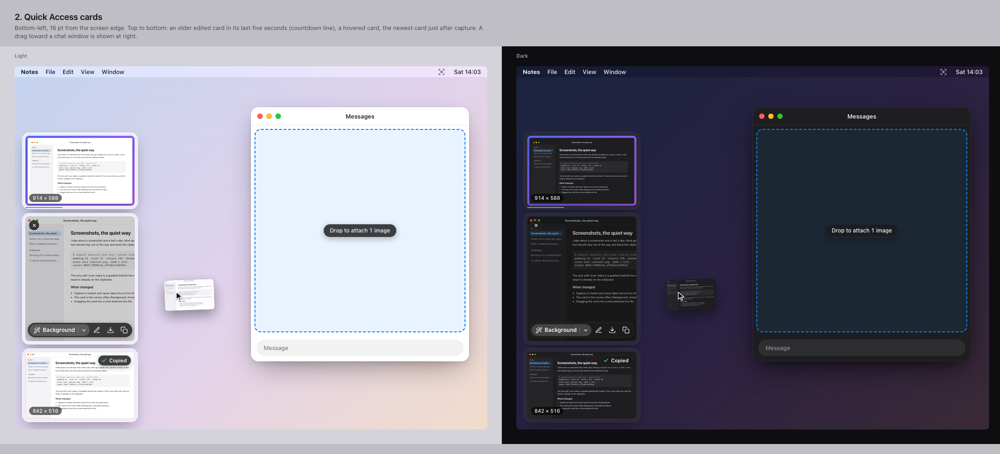

# Snap

Snap is a menu bar screenshot and screen recording app that replaces CleanShot X.



It is built for one Mac and the way its owner uses it: about one and a half screenshots a day, a gradient behind a window now and then, and a recording every few months. It runs offline. The only network code is the Sparkle update check in the installed app.

## What it does

- Area, window and fullscreen screenshots, plus an all-in-one toolbar. The dim overlay appears before the capture finishes, and Snap never takes focus from the app you capture.
- A Quick Access card in the corner after each capture. The image is already on the clipboard. From the card you can add a Background, annotate, save, copy, pin, or drag the file out.
- Background puts the capture on a gradient, mesh, color, image or a blurred copy of itself, with padding, inset, corners and shadow from your preset.
- Annotate has crop, rectangle, arrow, text, highlight, numbered steps, freehand, and redaction by pixelate, blur or black-out. Black-out is the only redaction that cannot be reversed.
- History keeps every capture for 3 days. Edited captures keep their annotations in `annotations.json`, so reopening one gives you every arrow, step and redaction to edit again, with the Background still applied on export.
- Pins float a capture above other windows, with opacity and click-through.
- Screen recording to mp4 (H.264 or HEVC, 30 or 60 fps), with system audio and microphone when you turn them on.
- While recording, Snap checks once a second that video frames and audio from each source keep arriving. After 3 s without them the menu bar timer turns amber and the menu says what stopped. Snap keeps recording; Stop keeps whatever was written.
- After a recording that asked for audio, the video card says "No audio track", "Microphone silent" or "System audio silent" when the file stays below -60 dBFS.
- When macOS asks to approve Screen Recording again and a capture fails for that reason, the menu bar symbol gets an orange dot and the menu shows "Screen Recording needs your OK". Clicking the row opens the right System Settings pane.

### Shortcuts

Global hotkeys, changeable in Settings > Shortcuts (recorder fields with conflict warnings). Snap does not register a combo while CleanShot X is running, and Settings warns about enabled macOS shortcuts that collide.

| Default | Action |
|---|---|
| Shift-Cmd-4 | Capture Area |
| Shift-Cmd-3 | Capture Fullscreen |
| Shift-Cmd-5 | All-in-One toolbar (also stops a recording) |
| unset | Capture Window, Record Screen, Stop Recording, Apply Background, Open in Annotate, Pin Last Capture, Open Capture History |

In the area overlay: Esc or right-click cancels, Space while dragging moves the rectangle, Shift constrains to a square, Option resizes from the center, arrow keys nudge 1 point (Shift 10), Space or Tab switches to window mode. On a hovered Quick Access card: C copy, Option-C copy file, S save, A annotate, B background, Delete or Esc close. Settings has five tabs: General, Capture, Quick Access, Recording, Shortcuts.

## Permissions and what it never does

- Screen Recording ("Screen & System Audio Recording"): needed for every capture and recording. A first-run window explains why and has one button that asks macOS. Snap asks once per install; after that it only shows a small hint when a hotkey is pressed without permission.
- Microphone: asked once, only when you turn the microphone on for recordings (Settings or the toolbar Options). Never at launch.
- Save folder: screenshots save to `~/Downloads` by default when Save is on.
- No Accessibility or Input Monitoring permission (hotkeys use Carbon `RegisterEventHotKey`).
- Never phones home: no analytics, no crash reporter, no upload. A lint rule rejects network code in `Sources/`; Sparkle is the one exception.
- Never steals focus from the app being captured, and never loses a capture: the PNG is written to history before the clipboard, save folder or overlay timer.
- Never changes system settings or other apps' shortcuts.

## Install and updates

```sh
scripts/bundle.sh --release --install    # builds build/bundle/Snap.app, signs it, copies it to ~/Applications
```

Install only when Snap is not running. Snap updates itself with Sparkle from the sdusteric/app-updates feed (contract: `../app-updates/CONTRACT.md`). It is signed with the same Apple Development identity each build so the Screen Recording grant survives rebuilds.

# Developer

## Requirements

macOS 27 on Apple Silicon, Swift 6.4, SwiftLint. Use your own scratch path, since several builds may run at once.

## Build, test, check

```sh
swift build --scratch-path "$TMPDIR/snap-dev"
SNAP_HOME=$(mktemp -d) swift test --scratch-path "$TMPDIR/snap-dev"
swiftlint lint --strict
SNAP_HOME=$(mktemp -d) SNAP_NO_UPDATES=1 scripts/check.sh   # every gate, logs in build/check/
SNAP_NO_UPDATES=1 scripts/accept.sh offline                 # milestone 1 acceptance
SNAP_NO_UPDATES=1 scripts/accept.sh m2                      # milestone 2 acceptance
scripts/bundle.sh --release                                 # build/bundle/Snap.app, signed, never launched
scripts/shots.sh [m2|m2-polish]                             # headless screenshots
scripts/release.sh [--notes <file.md>] [--dry-run <dir>]    # check.sh, release bundle, app-updates publish.sh
swift scripts/shot-stats.swift <png> [x y w h]              # size, luminance, mean RGBA of a region
swift scripts/winlist.swift <pid>                           # on-screen windows of one PID (exit 1 if any)
```

`docs/acceptance.md` describes each acceptance criterion and how it is checked. `scripts/release.sh` publishes a real update, so run it only with `--dry-run`.

Tests and tools never touch the screen, the microphone or the real pasteboard. Recording is tested with a fake recorder that writes real mp4 files from generated frames and tones. Shots render each surface from demo data in a process with no window, and `scripts/shots.sh` fails if the frontmost app changes or a window appears. Set `SNAP_HOME` to a fresh `mktemp -d` for every test, shot or `snapctl` run (the default save folder is then `$SNAP_HOME/Saved`), and set `SNAP_NO_UPDATES=1`.

## Layout

| Path | What |
|---|---|
| `Sources/SnapCore` | Pure logic, stores, the recording controller and fakes. No AppKit. History is the folder (`item.json` version 3, `annotations.json`) |
| `Sources/SnapSystem` | ScreenCaptureKit, CGWindowList, Carbon hotkeys, pasteboard, permission and microphone probes. The only target that may mention ScreenCaptureKit or `AVCaptureDevice` |
| `Sources/SnapUI` | Every surface, with all colors, sizes and timings in `Shared/Theme.swift` |
| `Sources/Snap` | The app and its headless `--shot` mode. The only target that links Sparkle (2.10.0) |
| `Sources/snapctl` | CLI: `gen-fixture`, `beautify`, `preset`, `history`, `record --fake`, `probe`, `annotate`. Never links ScreenCaptureKit or Sparkle |
| `Sources/snapbench` | Hotkey to overlay latency bench |
| `SNAP_HOME` | All state: settings, presets, history, logs. Defaults to `~/Library/Application Support/Snap` |

Design doc (source of truth): [docs/superpowers/specs/2026-10-24-snap-design.md](docs/superpowers/specs/2026-10-24-snap-design.md). The mockup in `docs/mockup` shows every surface in light and dark.

## Rules for agents

- Never show a window, take focus, capture the screen, record, open the microphone, register a hotkey or trigger a permission dialog from a test, tool or probe. Never run `open`, `screencapture` or osascript.
- The Snap binary runs only in `--shot` mode from `build/bundle/Snap.app/Contents/MacOS/Snap`, or as `snapctl`, always with `SNAP_HOME` set and `SNAP_NO_UPDATES=1`.
- Never read private folders (`~/Downloads`, `~/Desktop`, `~/Pictures`, `~/Movies`, iCloud Drive) or the real pasteboard (use `NSPasteboard(name:)`). No sound.
- No network code in `Sources/` (`URLSession`, `NWConnection`, `import Network`); never run `bundle.sh --install` from an agent run.
- No `try!` in `Sources/`, no `try?` in `SnapCore` store files. State files go through `AtomicFile`.
